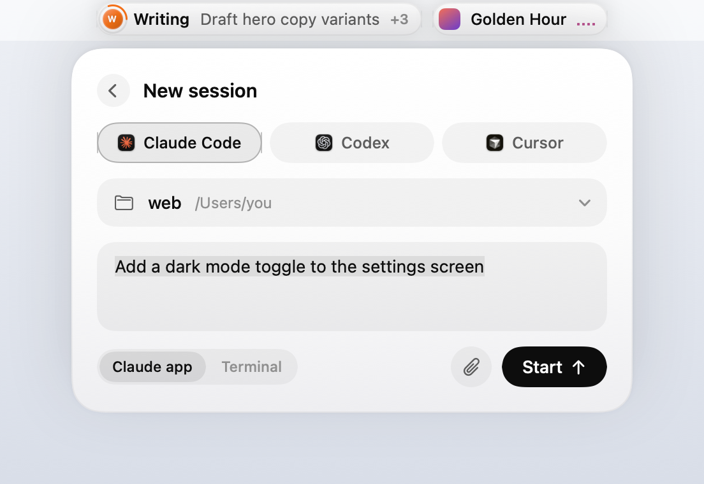
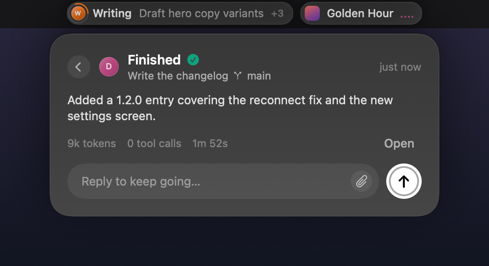
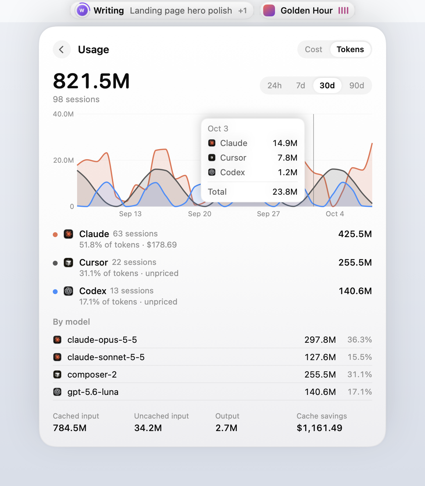
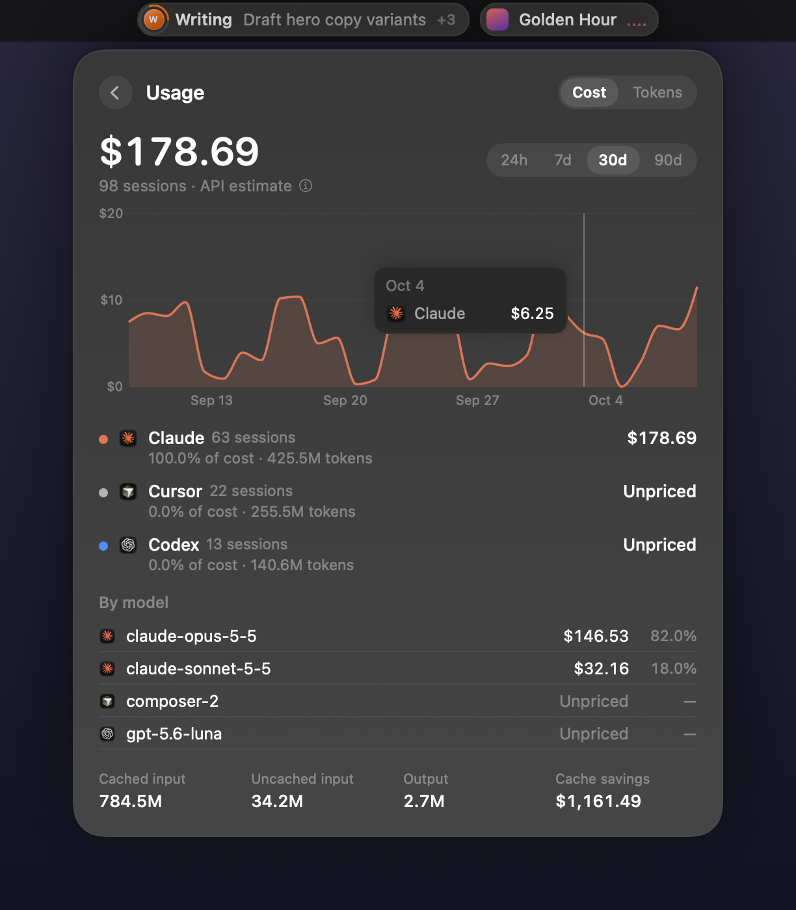

<p align="center">
  
</p>

<h1 align="center">Lintel</h1>

<p align="center">
  <b>Your AI agents and your music, living in the notch.</b><br>
  A tiny native macOS app that turns the MacBook notch (or the top of any display) into a live view of your<br>
  Claude Code, Cursor and Codex sessions — plus what's playing and what's up next.
</p>

<p align="center">
  
  
</p>

*A lintel is the beam across the top of a doorway. This one sits across the top of your screen.*

---

## Why

When you run several coding agents at once, you spend a lot of time checking terminals to see which one is stuck
waiting for you. Lintel puts all of them in one place, at the top of the screen. Approve a command, answer a question
or send a follow-up without leaving what you're doing. And since you're probably listening to music while they work,
the other side of the notch shows that too.

- **Native and light.** Swift + SwiftUI, no dependencies, a 1.6 MB download. It uses ~0% CPU at rest; spinners and
  equalisers animate in Core Animation, not in the app.
- **Local first.** Agents talk to Lintel over `127.0.0.1` with a private token. The only request Lintel makes itself
  is a daily look at this repo's latest release, which you can turn off.
- **Fails open.** If Lintel isn't running, your agents behave exactly as they would without it.

## Features

### Agents

| | Claude Code | Cursor | Codex |
|---|:---:|:---:|:---:|
| Live sessions, status, tool calls, tokens, model | ✅ | ✅ | ✅ |
| Title generated by the tool (not your first prompt) | ✅ ¹ | ✅ | ✅ |
| Approve / deny commands from the notch | ✅ | ✅ (opt-in, terminal commands) | ✅ ² |
| Answer the agent's multiple-choice questions | ✅ | — | — |
| Reply when a turn finishes (continues the same session) | ✅ | ✅ | ✅ ² |
| Jump to the exact chat / thread / terminal tab | ✅ ³ | app only | ✅ |
| Plan usage (5-hour + weekly window, reset time) | ✅ exact | plan + link | ✅ exact |
| Cost and token history | ✅ | ✅ ⁴ | ✅ |
| Start a new session from the notch | ✅ | ✅ | ✅ |

<sub>¹ For sessions in the Claude desktop app. Claude Code in a plain terminal doesn't generate titles, so those show
your prompt. ² Through Codex hooks, which Codex runs only after you approve them once (see below). ³ Claude desktop
sessions open the exact chat; Terminal and iTerm sessions select the exact tab. ⁴ Cursor keeps no usage on disk, so
Lintel records it from Cursor's hooks from the moment you connect.</sub>

- **One colour per session.** Each session gets a circle with the first letter of its project, ringed by a
  spinner while it works.
- **It asks for you.** Permission prompts and questions open the card by themselves, with a soft sound.
- **Start a session from the notch.** Press **+**, pick Claude Code, Codex or Cursor and a project folder, type
  the task and hit Start. It opens in the tool's own app, or in your terminal (Terminal, iTerm or Ghostty) running
  the tool's CLI, and shows up in the list like any other session.
- **Images, too.** Attach screenshots or pictures to a new session or a reply with 📎, or paste them with ⌘V. Each one is saved as a file
  and its path goes into the message, so the agent can open it.
- **Reply to keep going.** A finished turn shows the agent's summary and a reply box. Your reply continues the same
  session in place. A ring on the send button shows how long the turn stays open, and while you're typing it stays
  open for up to 10 minutes. Drafts are kept per session, so closing the card doesn't lose them.
- **Subagents fold under their parent**, so a busy session stays one row until you open it.
- **Usage at a glance.** The bottom of the card shows how much of your plan is left and when it resets, even when
  no agent is running. You get a notification at 80% and 100% of a window.
- **Sounds that work.** Pick one for *needs you* and one for *finished* (with a preview). They're muted when you're
  already looking at that session's app.
- **More than one account.** Extra logins in `~/.claude-*` (Claude Code's `CLAUDE_CONFIG_DIR`) and `~/.codex-*`
  (`CODEX_HOME`) show up on their own, each with its own usage.

<p align="center">
  
  
</p>
<p align="center">
  
  
</p>
<p align="center">
  
  
</p>

### Close the lid, agents keep going

Close the lid and walk away: the agents Lintel shows keep running, and everything they don't need is paused.

- **No timer.** While an agent is working (or waiting on you, for up to your prompt timeout) the Mac doesn't sleep.
  A couple of minutes after the last one finishes, Lintel turns sleep back on, and with the lid closed the Mac
  sleeps right away.
- **Only your agents run.** With the lid closed, Lintel pauses every Dock app that isn't hosting a session (Slack,
  Discord, Messages, Spotify, Figma…), turns the display off and turns on Low Power Mode. Terminals, editors, the
  Claude, Codex and Cursor apps, browsers, meeting apps and password managers keep running. Opening the lid resumes
  everything. With an external display connected, nothing is paused.
- **Hotspot Hopper.** If the Wi-Fi drops while the lid is closed (you left the office with it under your arm),
  Lintel joins your iPhone's Personal Hotspot so the agents' API calls keep going.
- **Safe by default.** Below 10% battery, or when the Mac gets critically hot, it sleeps anyway. If Lintel quits or
  crashes, a small watchdog turns sleep back on and resumes the paused apps within a minute. Use a well-ventilated
  surface, not a closed bag.

It needs a one-time setup in Settings › When the lid closes (your admin password; see
[How it works](#close-the-lid-how-it-works)). The approach comes from [Insomnia](https://github.com/krishhgg/Insomnia)
(MIT).

### Usage history

What your agents used over the last 24 hours, 7, 30 or 90 days, as **cost** or **tokens**, per tool and per model,
with cache savings. Hover the chart to see a day. Cost is an *API estimate*: what the same tokens would cost at
Anthropic's list prices. Subscriptions bill differently, and models without a published price (Cursor's, OpenAI's)
are shown as unpriced rather than guessed. Open it from the menu bar (*Usage History*) or by clicking the usage line.

<p align="center">
  
  
</p>

### Music

- **Any player.** Apple Music, Spotify, YouTube Music in any browser (Chrome, Arc, Dia, Brave, Edge, Safari)…
  Whatever macOS considers "Now Playing" shows up, with no setup.
- **The real up-next queue** for apps that publish one (Apple Music, including AutoPlay). YouTube Music's queue is
  read from the page. Click a song in *Up next* to play it.
- **Controls.** Play / pause / skip, and click or drag the progress bar to seek. Click the cover to jump to the
  player, including the exact YouTube Music tab.
- **Optional.** Turn the music player off in Settings and Lintel is just your agents.

<p align="center">
  
  
</p>

### Notch and displays

- **On a notched MacBook,** the notch quietly stays a notch, so your menu bar icons are never covered. It grows
  wings (agents left, music right) when you hover it, when an agent needs you, and briefly when the song changes. A
  thin glowing line under the notch shows that something is working. Prefer always-visible wings? It's a setting.
- **On an external display,** you get two capsules at the top edge.
- **Follows the display you're using,** starting on your main display.
- **Light, Dark or System** appearance (dark cards are frosted glass). Lives in the menu bar; the menu bar icon can
  be hidden too.

## Requirements

- macOS 15 Sequoia or later. Developed and tested on macOS 27, Apple Silicon.
- To build it yourself: Xcode or the Command Line Tools (Swift 6). `xcode-select --install` is enough.
- Optional: [Claude Code](https://code.claude.com), [Cursor](https://cursor.com) and/or
  [Codex](https://openai.com/codex), the agents Lintel follows.

## Install

### Download

1. Download `Lintel-x.y.z.dmg` from the [latest release](https://github.com/imRazvanBadea/lintel/releases/latest).
2. Open it and drag **Lintel** into **Applications**.
3. Open Lintel. macOS will say it can't verify the developer, because Lintel isn't signed with a paid Apple
   Developer ID. Click **Done**, then go to **System Settings › Privacy & Security**, scroll down and click
   **Open Anyway** next to the message about Lintel. You only do this once.

   Prefer the terminal? `xattr -dr com.apple.quarantine /Applications/Lintel.app` does the same.

Settings open on first launch. **Updates** install themselves from then on: Lintel checks this repo's latest release
once a day, downloads the DMG, checks it against the SHA-256 GitHub publishes for it, swaps itself and relaunches.
You can check by hand or switch this off in Settings › Updates.

### Build from source

```bash
git clone https://github.com/imRazvanBadea/lintel.git
cd lintel
./scripts/build.sh --install
```

This builds a release `Lintel.app`, copies it to `~/Applications` and launches it. Because you build it yourself,
macOS doesn't quarantine it, and you won't get the warning above.

> On an Intel Mac, change `--arch arm64` to `--arch x86_64` (and `-arch arm64` for the bridge) in
> `scripts/build.sh`.

### Connect your agents

Use the menu bar icon or Settings › Agents:

- **Connect Claude Code** adds Lintel's hooks to `~/.claude/settings.json`. If you don't already have a status line,
  it also registers one (it prints nothing, so your terminal looks the same); that's how Lintel gets plan usage
  updates. A backup is saved next to the file as `settings.json.lintel-backup`.
- **Connect Cursor** adds hooks to `~/.cursor/hooks.json`, again with a `.lintel-backup` next to it.
- **Connect Codex** adds hooks to `~/.codex/hooks.json` (backup next to it) and turns on `[features] hooks` in
  `~/.codex/config.toml`. Codex runs new hooks only after you approve them: open Codex, type `/hooks` and approve
  Lintel's four hooks (Settings › Agents has an *Approve in Codex…* button that does the typing). Without the hooks
  Lintel still follows Codex from `~/.codex/sessions`, view-only.

Sessions that start after connecting show up. **Disconnect** removes only Lintel's entries.

### Permissions macOS will ask for

| Prompt | Why |
|---|---|
| *Lintel wants to control Terminal / iTerm* | To bring the exact tab of a session to the front when you jump to it. |
| *Lintel wants to control Dia / Chrome / Safari…* | To read YouTube Music's up-next queue and focus its tab. Also turn on **Allow JavaScript from Apple Events** in the browser (Chromium browsers: View › Developer; Safari: Develop). |
| *Device Control and Data Access* (Accessibility before macOS 27) | Only if you play YouTube Music in a Safari web app (Add to Dock): those can't be scripted, so Lintel reads the up-next list from the window instead. |
| *Lintel wants to make changes* (admin password) | Only when you click **Set Up** for the lid-closed mode, once. |
| *Lintel would like to use your location* | Only if you turn on Hotspot Hopper: macOS shows Wi-Fi names only to apps with Location access. Lintel never reads your location. |

No Screen Recording or Full Disk Access permission is needed.

## Using it

| | |
|---|---|
| Hover the notch / a capsule | Open its card. Moving away closes it. |
| Click | Pin the card open. |
| `⌃⌥Space` | Toggle agents |
| `⌃⌥M` | Toggle music |
| `⌃⌥,` | Settings (also: open Lintel again from Spotlight) |
| `⌘1` … `⌘9` (card focused) | Jump to that session |
| `⌘↩` | Allow / submit |
| `Esc` | Back / close |

**About Researching / Reasoning / Writing / Reviewing.** These are Lintel's own at-a-glance labels, inferred from the
tool the agent is using right now. Agents don't report them.

- **Researching:** reading or searching files, listing folders, fetching web pages.
- **Reasoning:** thinking or planning before a tool call, or updating a to-do list.
- **Writing:** editing or creating files, or running commands that change things.
- **Reviewing:** running tests, builds, linters or `git status`, and the finished state.

**Replies.** A finished Claude Code, Cursor or Codex turn is held open for 25 s by default (configurable up to
9 minutes; while you're typing it stays open for up to 10). A reply typed in the notch continues the same session.
It can't be open-ended: the agent counts the turn as running while Lintel holds it.

**Prompts you don't answer** go back to the agent's own UI after 10 minutes (configurable), or straight away with
*Answer in terminal*.

## How it works

```
Claude Code ── hooks ─┐                                          ┌─▶ allow / deny / answers / reply (JSON back)
Cursor ────── hooks ──┼─▶ ~/.lintel/bin/lintel-hook ── 127.0.0.1:47821 + token ──▶ Lintel
Codex ─────── hooks ──┤
Claude Code status line (plan usage) ┘
Claude Code `get_usage` request ─────────────────────────────▶ Lintel   (exact usage, no model call)
Codex ── ~/.codex/sessions/**/rollout-*.jsonl ── FSEvents ───▶ Lintel   (status, tools, rate limits)
macOS Now Playing (MediaRemote) ── bridge inside /usr/bin/perl ──▶ Lintel   (any player, queue, controls)
YouTube Music tab ── AppleScript → page JavaScript ──────────▶ Lintel   (up-next queue only)
```

- **Agents.** Claude Code, Cursor and Codex run `~/.lintel/bin/lintel-hook` for each event: a tiny compiled helper
  (no shell, no curl, ~10 ms) that forwards the event to Lintel and prints Lintel's answer back to the agent. If
  Lintel isn't running it prints nothing and exits 0, so the agent carries on as usual. Permission prompts use the
  `PermissionRequest` hook (Claude Code, Codex) and Cursor's `beforeShellExecution`. Replies use the `Stop` hook
  (`decision: block`) and Cursor's `stop` hook (`followup_message`).
- **Titles** come from the Claude app's session metadata, Cursor's `state.vscdb` (read-only) and Codex's
  `session_index.jsonl`.
- **Plan usage.** For Claude, Lintel asks Claude Code itself. It runs `claude -p` in stream-json mode with hooks
  disabled and no session saved, and sends one `get_usage` request. That's the same data behind `/usage`, with no
  model call. It does this at launch and every few minutes while a Claude session is open. For Codex, Lintel reads
  the `rate_limits` Codex writes to its session logs. Cursor keeps usage behind its login, so Lintel only shows your
  plan.
- **Usage history** is read from the transcripts Claude Code and Codex already keep (`~/.claude/projects`,
  `~/.codex/sessions`), in the background, and cached in `~/Library/Caches/Lintel`. Cursor's comes from its hooks
  and is kept in `~/.lintel/cursor-usage.jsonl`.
- **Music.** Since macOS 15.4 the system Now Playing service only answers Apple-signed processes. So a ~160-line
  bridge (`Bridge/LintelNowPlaying.m`) is loaded into `/usr/bin/perl` and streams JSON to Lintel over a pipe. It's
  event-driven; nothing polls.

### Close the lid: how it works

macOS has no public way to keep a laptop on battery awake with the lid closed. Lintel uses `pmset -a disablesleep`,
which needs root. **Set Up** asks for your admin password once and installs:

- `/etc/sudoers.d/lintel`, letting your account run exactly these four commands without a password (checked with
  `visudo` first):
  `pmset -a disablesleep 1`, `pmset -a disablesleep 0`, `pmset -b lowpowermode 1`, `pmset -b lowpowermode 0`.
  Any program running as you could use that rule too, so it's limited to those four.
- A watchdog, `~/Library/LaunchAgents/com.razvanbadea.lintel.backstop.plist`, which runs
  `~/Library/Application Support/Lintel/backstop.sh` every minute. It does nothing while Lintel is running.

Sleep has to be off *before* the lid closes (a normal Mac is asleep before any app hears about it), so Lintel turns
it off as soon as an agent starts working, not when the lid closes. The lid itself is watched through IOKit. Apps are
paused with `SIGSTOP` and resumed with `SIGCONT`, and before pausing anything Lintel writes what it changed to
`~/Library/Application Support/Lintel/awake.json`, so the watchdog or the next launch can undo it. It only resumes
processes whose start time matches what it recorded. The display goes off with `pmset displaysleepnow`. A working
agent with no news for 30 minutes counts as stuck and stops keeping the Mac awake. The hotspot password is kept in your
login Keychain and the network is joined with CoreWLAN.

### Privacy and security

- The hook server listens only on `127.0.0.1`, and every request must carry a random token from
  `~/.lintel/token` (mode `0600`). The helper reads the token from that file, so it never appears in `ps`.
- **Network.** Lintel's only request of its own is the daily update check to `api.github.com` (and the DMG download
  when there's an update); turn it off in Settings › Updates. The usage check runs your own Claude Code, which talks
  to Anthropic as it always does.
- **Stored:** your preferences (`UserDefaults`, including the folders you started sessions in), `~/.lintel/` (hook
  helper, token, Cursor usage log, images you attached, cleaned up automatically) and the usage history cache in
  `~/Library/Caches/Lintel`.

## Limitations

- **Private APIs.** Music uses macOS's private MediaRemote framework and Claude Code's experimental `get_usage`
  request. A future macOS or Claude Code release may change them.
- **Codex** can't ask multiple-choice questions through hooks, and its approvals answer *allow* or *deny* only (no
  "always allow"). **Cursor** can't link to a specific conversation, and its plan usage needs your Cursor login,
  which Lintel doesn't touch.
- **Not notarized.** Without a paid Apple Developer ID the first launch needs *Open Anyway* (see Install). Updates
  after that install without asking.
- **Regular Claude chats** (claude.ai or the desktop app's Chat tab) aren't shown. They expose no hooks or local
  state for other apps to follow. Claude Code sessions in the desktop app are shown.
- **Lid closed.** The built-in microphone is disconnected in hardware when the lid closes. A single tool call that
  runs longer than 30 minutes without any hook event (a very long build or test run) counts as stuck. Hotspot Hopper
  needs the iPhone nearby with Personal Hotspot available; because Lintel is ad-hoc signed, macOS may ask once after an
  update before Lintel can read the hotspot password again.
- **The notch** can't detect where other apps' menu bar icons are, which is why the default notch style stays tucked
  in.

## Development

```
Sources/Lintel/
  App/      main, AppDelegate (menu bar, hotkeys, dev commands), NotchPanel (window + mouse), IslandModel, Settings,
            Sounds, Spawn, Updater
  Agents/   HookServer, AgentHooks (installer), AgentStore, AgentModels, CodexWatcher, FeedReader, TitleResolver,
            Launcher (new sessions), Attachments, UsageStore, UsageAlerts, UsageHistory, Pricing, Proc
  Music/    NowPlaying, NowPlayingBridge, WebQueueReader, ScriptRunner
  UI/       RootView (notch / capsules), AgentViews, NewSessionView, ReplyBar, AttachmentViews, UsageDashboard,
            MusicViews, Avatar, Theme, SettingsView
Sources/LintelHook/   the hook helper agents run (raw sockets, no dependencies)
Bridge/     LintelNowPlaying.m — MediaRemote bridge, built into the app by build.sh
scripts/    build.sh, release.sh, screenshots.sh, compose-shot.swift, make-icon.swift, simulate.sh
```

```bash
swift build                      # quick compile check
./scripts/build.sh               # build/Lintel.app
./scripts/build.sh --install     # …and install to ~/Applications + launch
./scripts/release.sh             # build/Lintel-<version>.dmg (version from Resources/Info.plist)
./scripts/release.sh --publish   # …and create the GitHub release with the DMG (needs gh)
./scripts/screenshots.sh         # regenerate docs/images from demo mode (needs a running Lintel)
```

`scripts/simulate.sh` drives a running Lintel with fake hook events and developer commands. It's handy for UI work
without real agents:

```bash
scripts/simulate.sh UserPromptSubmit '{"session_id":"demo","cwd":"'$PWD'","prompt":"Try it"}'
scripts/simulate.sh debug demo             # fill Lintel with made-up sessions and music (30 s)
scripts/simulate.sh debug agents           # open the agents card  (also: music, collapse)
scripts/simulate.sh debug theme-dark       # theme-light / theme-system
scripts/simulate.sh debug snapshot         # render the panel to $TMPDIR/lintel-snapshot.png
scripts/simulate.sh debug state            # sessions / pending requests / music / usage as JSON
scripts/simulate.sh debug usage            # open the usage history (usage-range-30d, usage-tokens, usage-hover-3…)
```

Contributions are welcome: issues, ideas and pull requests. Please keep the app light (no dependencies, nothing that
polls when it doesn't have to) and test both themes and both the notch and capsule layouts.

## Uninstall

1. Settings › When the lid closes › **Remove…** (removes the sudoers rule and the watchdog).
1. Settings › Agents › **Disconnect** Claude Code, Cursor and Codex. This removes only Lintel's entries, including
   the status line it added.
2. Quit Lintel from the menu bar icon.
3. Delete `Lintel.app` (from Applications or `~/Applications`), `~/.lintel`, `~/Library/Caches/Lintel` and
   `~/Library/Application Support/Lintel`.

## Trademarks

Lintel is an independent open-source project, not affiliated with Anthropic, Anysphere (Cursor), OpenAI or Apple.
All trademarks belong to their owners.

## License

[MIT](LICENSE) © 2026 Razvan Badea
