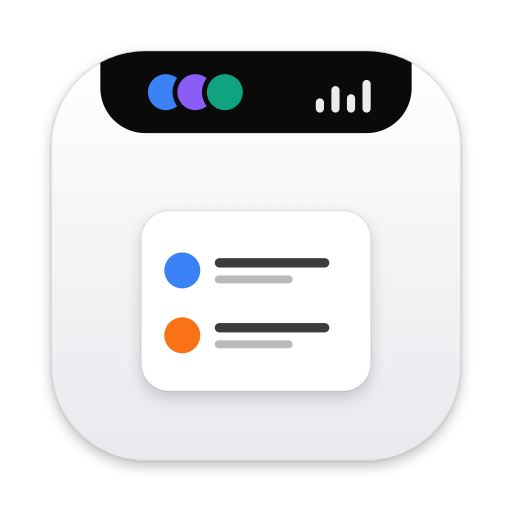
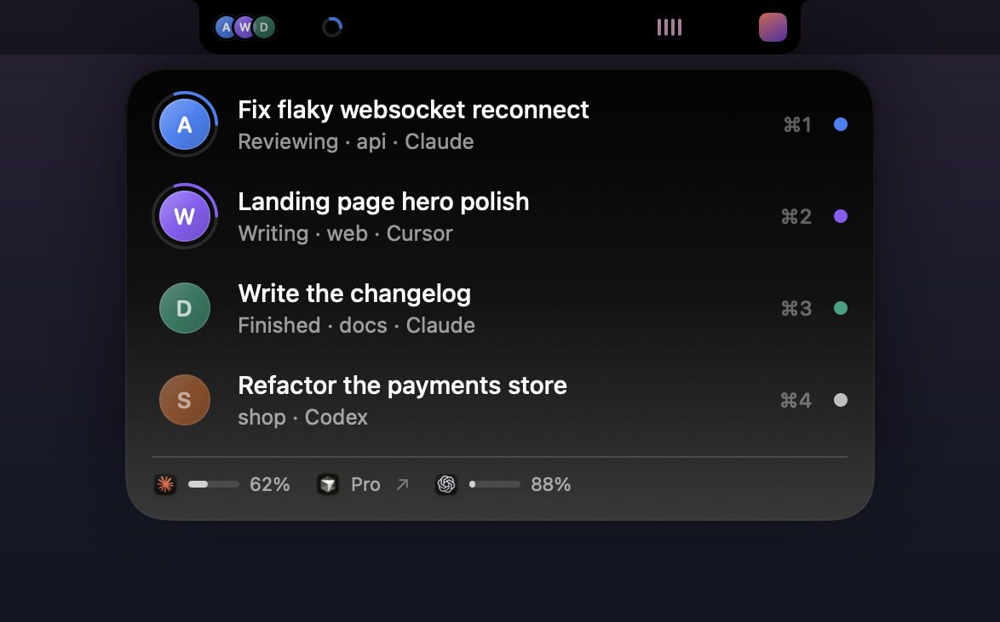
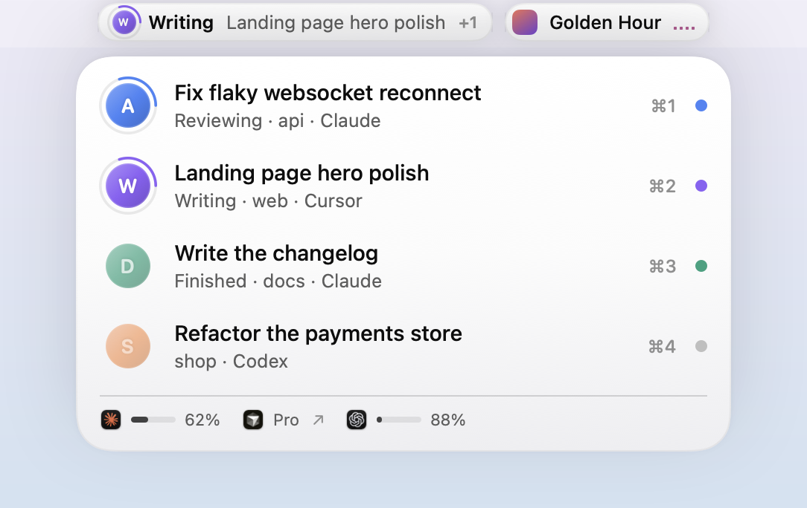
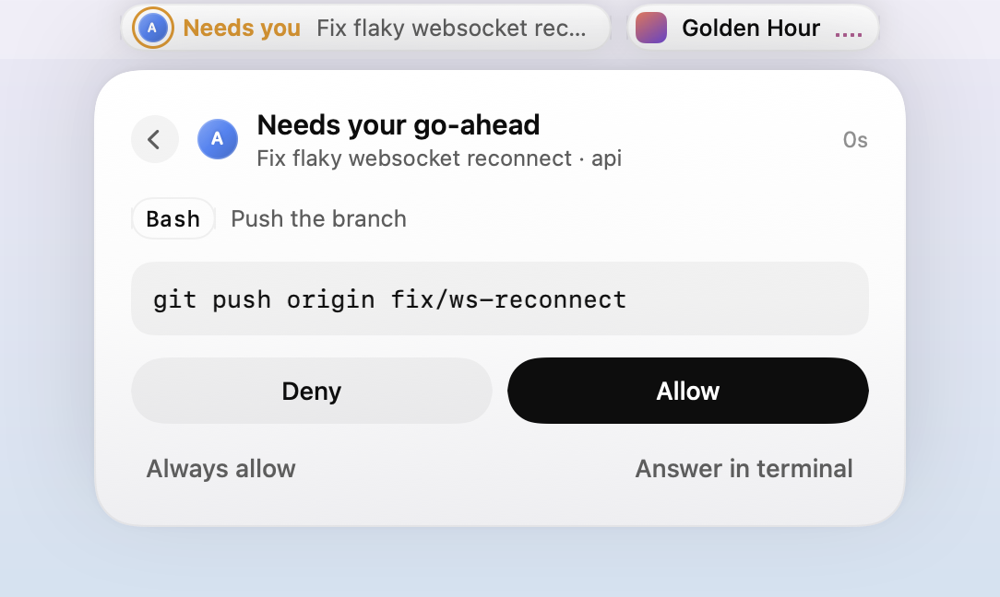
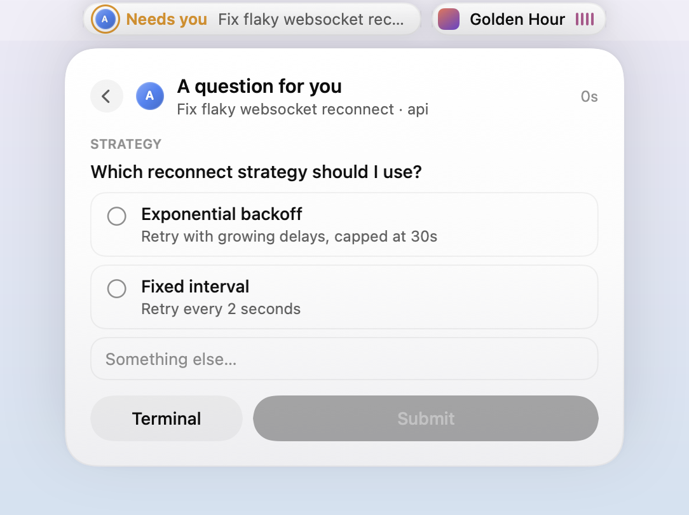
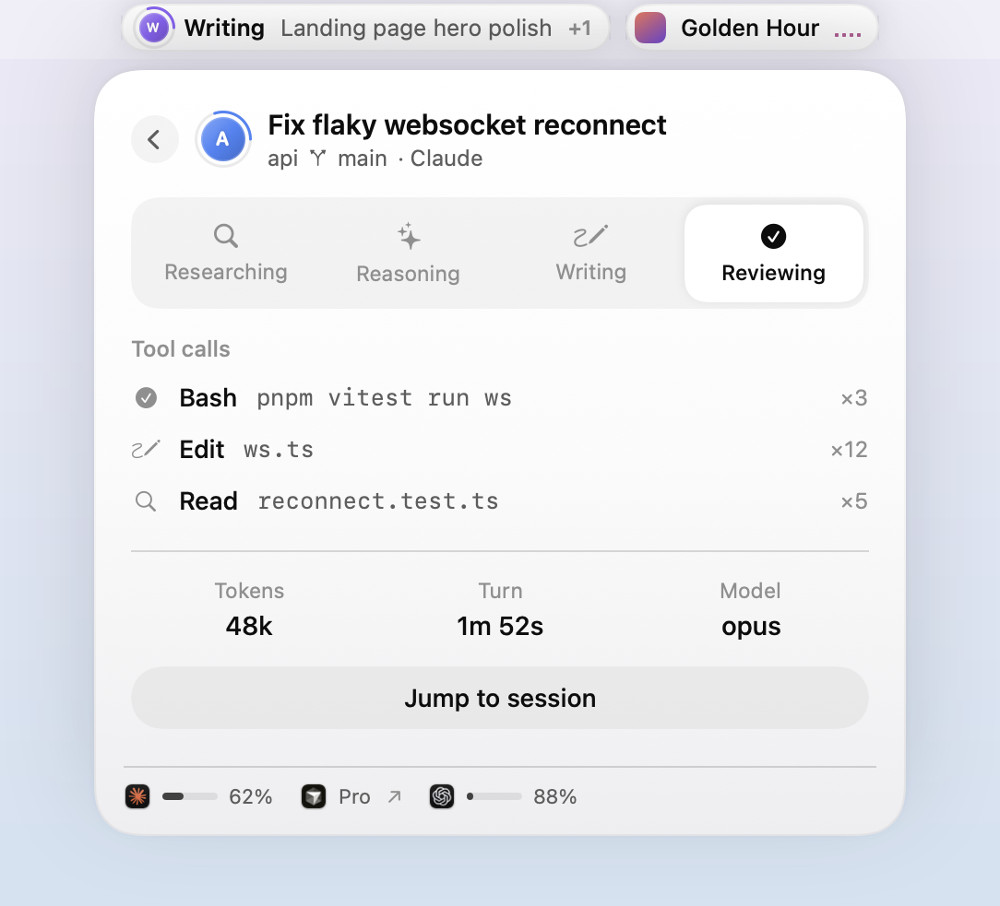
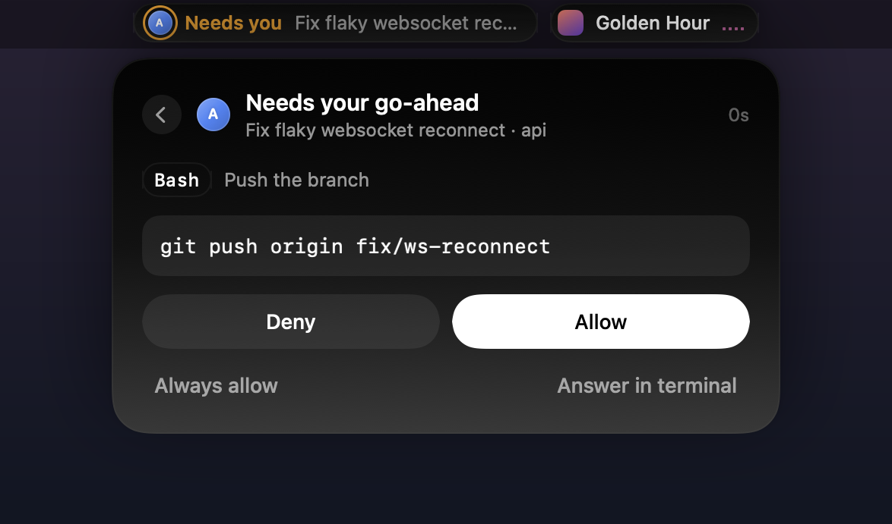
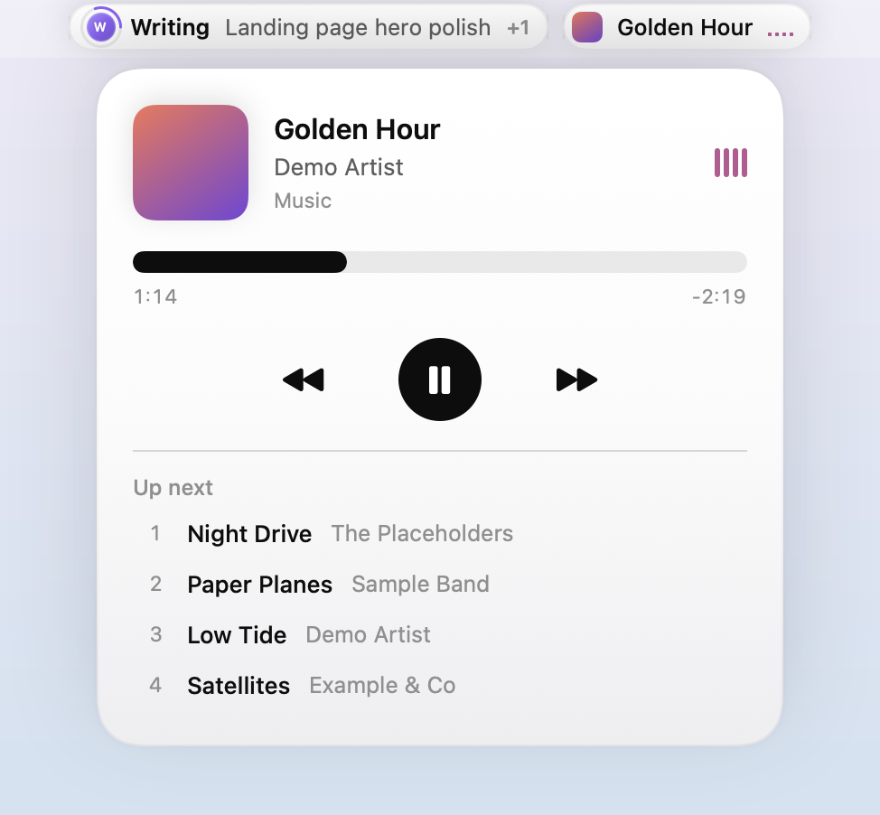
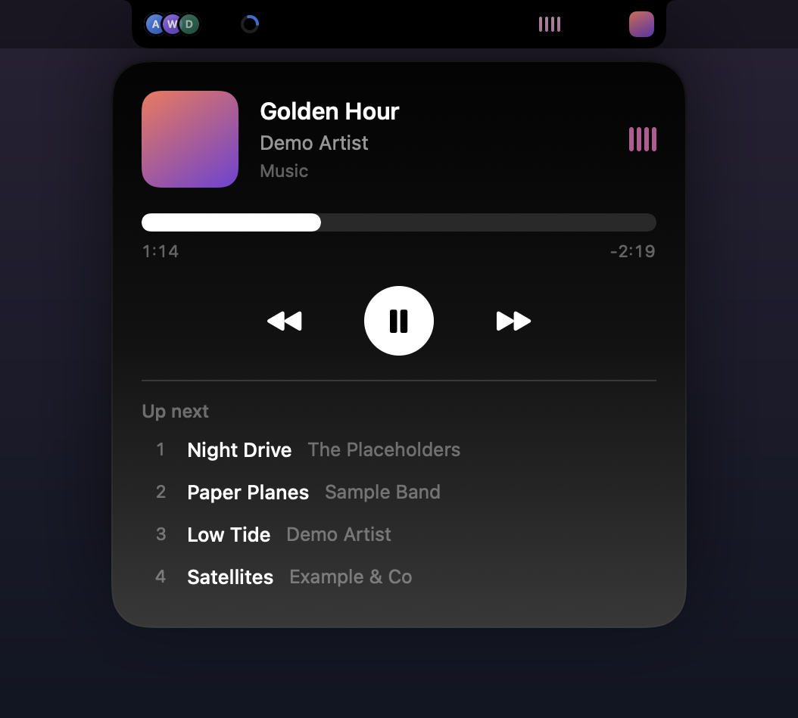

<p align="center">
  
</p>

<h1 align="center">Lintel</h1>

<p align="center">
  <b>Your AI agents and your music, living in the notch.</b><br>
  A tiny native macOS app that turns the MacBook notch (or the top of any display) into a live view of your<br>
  Claude Code, Cursor and Codex sessions — plus what's playing and what's up next.
</p>

<p align="center">
  
  
</p>

*A lintel is the beam across the top of a doorway. This one sits across the top of your screen.*

---

## Why

When you run several coding agents at once, you spend a lot of time checking terminals to see which one is stuck
waiting for you. Lintel puts all of them in one place, at the top of the screen. Approve a command, answer a question
or send a follow-up without leaving what you're doing. And since you're probably listening to music while they work,
the other side of the notch shows that too.

- **Native and light.** Swift + SwiftUI, no dependencies, ~2 MB. It uses ~0% CPU at rest; spinners and equalisers
  animate in Core Animation, not in the app.
- **Local only.** Lintel never makes a network request. Agents talk to it over `127.0.0.1` with a private token.
- **Fails open.** If Lintel isn't running, your agents behave exactly as they would without it.

## Features

### Agents

| | Claude Code | Cursor | Codex |
|---|:---:|:---:|:---:|
| Live sessions, status, tool calls, tokens, model | ✅ | ✅ | ✅ |
| Title generated by the tool (not your first prompt) | ✅ ¹ | ✅ | ✅ |
| Approve / deny commands from the notch | ✅ | ✅ (opt-in, terminal commands) | — ² |
| Answer the agent's multiple-choice questions | ✅ | — | — |
| Reply when a turn finishes (continues the same session) | ✅ | ✅ | — |
| Jump to the exact chat / thread / terminal tab | ✅ ³ | app only | ✅ |
| Plan usage (5-hour + weekly window, reset time) | ✅ exact | plan + link | ✅ exact |

<sub>¹ For sessions in the Claude desktop app. Claude Code in a plain terminal doesn't generate titles, so those show
your prompt. ² Codex has no way for other apps to answer its approvals; Lintel flags them with an *Open Codex*
button. ³ Claude desktop sessions open the exact chat; Terminal and iTerm sessions select the exact tab.</sub>

- **One colour per session.** Each session gets a circle with the first letter of its project, ringed by a
  spinner while it works.
- **It asks for you.** Permission prompts and questions open the card by themselves, with a soft sound.
- **Finished turns** show the agent's summary and a reply box for a few seconds.
- **Usage at a glance.** The bottom of the card shows how much of your plan is left and when it resets.

<p align="center">
  
  
</p>
<p align="center">
  
  
</p>

### Music

- **Any player.** Apple Music, Spotify, YouTube Music in any browser (Chrome, Arc, Dia, Brave, Edge, Safari)…
  Whatever macOS considers "Now Playing" shows up, with no setup.
- **The real up-next queue** for apps that publish one (Apple Music, including AutoPlay). YouTube Music's queue is
  read from the page. Click a song in *Up next* to play it.
- **Controls.** Play / pause / skip, and click or drag the progress bar to seek. Click the cover to jump to the
  player, including the exact YouTube Music tab.

<p align="center">
  
  
</p>

### Notch and displays

- **On a notched MacBook,** the notch quietly stays a notch, so your menu bar icons are never covered. It grows
  wings (agents left, music right) when you hover it, when an agent needs you, and briefly when the song changes. A
  thin glowing line under the notch shows that something is working. Prefer always-visible wings? It's a setting.
- **On an external display,** you get two capsules at the top edge.
- **Follows the display you're using,** starting on your main display.
- **Light, Dark or System** appearance. Lives in the menu bar; the menu bar icon can be hidden too.

## Requirements

- macOS 15 Sequoia or later. Developed and tested on macOS 27, Apple Silicon.
- Xcode or the Command Line Tools (Swift 6), to build it. `xcode-select --install` is enough.
- Optional: [Claude Code](https://code.claude.com), [Cursor](https://cursor.com) and/or
  [Codex](https://openai.com/codex), the agents Lintel follows.

## Install

```bash
git clone https://github.com/imRazvanBadea/lintel.git
cd lintel
./scripts/build.sh --install
```

This builds a release `Lintel.app`, copies it to `~/Applications` and launches it. Settings open on first launch.
Because you build it yourself, macOS doesn't quarantine it, and you won't get an "unidentified developer" warning.

> On an Intel Mac, change `--arch arm64` to `--arch x86_64` (and `-arch arm64` for the bridge) in
> `scripts/build.sh`.

### Connect your agents

Use the menu bar icon or Settings › Agents:

- **Connect Claude Code** adds Lintel's hooks to `~/.claude/settings.json`. If you don't already have a status line,
  it also registers one (it prints nothing, so your terminal looks the same); that's how Lintel gets plan usage
  updates. A backup is saved next to the file as `settings.json.lintel-backup`.
- **Connect Cursor** adds hooks to `~/.cursor/hooks.json`, again with a `.lintel-backup` next to it.
- **Codex** needs nothing: Lintel reads `~/.codex/sessions` (desktop app and CLI). It can be switched off in Settings.

Sessions that start after connecting show up. **Disconnect** removes only Lintel's entries.

### Permissions macOS will ask for

| Prompt | Why |
|---|---|
| *Lintel wants to control Terminal / iTerm* | To bring the exact tab of a session to the front when you jump to it. |
| *Lintel wants to control Dia / Chrome / Safari…* | To read YouTube Music's up-next queue and focus its tab. Also turn on **Allow JavaScript from Apple Events** in the browser (Chromium browsers: View › Developer; Safari: Develop). |

No Accessibility, Screen Recording or Full Disk Access permission is needed.

## Using it

| | |
|---|---|
| Hover the notch / a capsule | Open its card. Moving away closes it. |
| Click | Pin the card open. |
| `⌃⌥Space` | Toggle agents |
| `⌃⌥M` | Toggle music |
| `⌃⌥,` | Settings (also: open Lintel again from Spotlight) |
| `⌘1` … `⌘9` (card focused) | Jump to that session |
| `⌘↩` | Allow / submit |
| `Esc` | Back / close |

**About Researching / Reasoning / Writing / Reviewing.** These are Lintel's own at-a-glance labels, inferred from the
tool the agent is using right now. Agents don't report them.

- **Researching:** reading or searching files, listing folders, fetching web pages.
- **Reasoning:** thinking or planning before a tool call, or updating a to-do list.
- **Writing:** editing or creating files, or running commands that change things.
- **Reviewing:** running tests, builds, linters or `git status`, and the finished state.

**Replies.** A finished Claude Code or Cursor turn is held open for 25 s by default (configurable up to 2 min;
typing pauses the countdown). A reply typed in the notch continues the same session. It can't be open-ended: the
agent counts the turn as running while Lintel holds it.

**Prompts you don't answer** go back to the agent's own UI after 10 minutes (configurable), or straight away with
*Answer in terminal*.

## How it works

```
Claude Code ── hooks ─┐                                  ┌─▶ allow / deny / answers / reply (JSON back)
Cursor ────── hooks ──┼─▶ ~/.lintel/hook.sh ── HTTP 127.0.0.1:47821 + token ──▶ Lintel
                      │
Claude Code status line (plan usage) ┘
Claude Code `get_usage` request ─────────────────────────────▶ Lintel   (exact usage, no model call)
Codex ── ~/.codex/sessions/**/rollout-*.jsonl ── FSEvents ───▶ Lintel   (status, tools, rate limits)
macOS Now Playing (MediaRemote) ── bridge inside /usr/bin/perl ──▶ Lintel   (any player, queue, controls)
YouTube Music tab ── AppleScript → page JavaScript ──────────▶ Lintel   (up-next queue only)
```

- **Agents.** Claude Code and Cursor call `~/.lintel/hook.sh` for each event. The script forwards the event to
  Lintel and prints Lintel's answer back to the agent. Permission prompts use Claude Code's `PermissionRequest`
  hook and Cursor's `beforeShellExecution`. Replies use Claude Code's `Stop` hook (`decision: block`) and Cursor's
  `stop` hook (`followup_message`).
- **Titles** come from the Claude app's session metadata, Cursor's `state.vscdb` (read-only) and Codex's
  `session_index.jsonl`.
- **Plan usage.** For Claude, Lintel asks Claude Code itself. It runs `claude -p` in stream-json mode with hooks
  disabled and no session saved, and sends one `get_usage` request. That's the same data behind `/usage`, with no
  model call. It does this every few minutes while a Claude session is open. For Codex, Lintel reads the
  `rate_limits` Codex writes to its session logs. Cursor keeps usage behind its login, so Lintel only shows your plan.
- **Music.** Since macOS 15.4 the system Now Playing service only answers Apple-signed processes. So a ~160-line
  bridge (`Bridge/LintelNowPlaying.m`) is loaded into `/usr/bin/perl` and streams JSON to Lintel over a pipe. The
  same technique is used by other now-playing utilities. It's event-driven; nothing polls.

### Privacy and security

- The hook server listens only on `127.0.0.1`, and every request must carry a random token from
  `~/.lintel/token` (mode `0600`). The hook script reads the token from a file, so it never appears in `ps`.
- Lintel itself makes **no network requests**. The usage check runs your own Claude Code, which talks to Anthropic as
  it always does.
- Nothing is stored except your preferences (`UserDefaults`) and `~/.lintel/` (hook script, token).

## Limitations

- **Private APIs.** Music uses macOS's private MediaRemote framework and Claude Code's experimental `get_usage`
  request. A future macOS or Claude Code release may change them.
- **Codex** is view-only (see above). **Cursor** can't link to a specific conversation, and its usage numbers need
  your Cursor login, which Lintel doesn't touch.
- **Regular Claude chats** (claude.ai or the desktop app's Chat tab) aren't shown. They expose no hooks or local
  state for other apps to follow. Claude Code sessions in the desktop app are shown.
- **The notch** can't detect where other apps' menu bar icons are, which is why the default notch style stays tucked
  in.

## Development

```
Sources/Lintel/
  App/      main, AppDelegate (menu bar, hotkeys, dev commands), NotchPanel (window + mouse), IslandModel, Settings
  Agents/   HookServer, AgentHooks (installer), AgentStore, AgentModels, CodexWatcher, TitleResolver, UsageStore, Proc
  Music/    NowPlaying, NowPlayingBridge, WebQueueReader, ScriptRunner
  UI/       RootView (notch / capsules), AgentViews, MusicViews, Avatar, Theme, SettingsView
Bridge/     LintelNowPlaying.m — MediaRemote bridge, built into the app by build.sh
scripts/    build.sh, make-icon.swift, simulate.sh
```

```bash
swift build                      # quick compile check
./scripts/build.sh               # build/Lintel.app
./scripts/build.sh --install     # …and install to ~/Applications + launch
```

`scripts/simulate.sh` drives a running Lintel with fake hook events and developer commands. It's handy for UI work
without real agents:

```bash
scripts/simulate.sh UserPromptSubmit '{"session_id":"demo","cwd":"'$PWD'","prompt":"Try it"}'
scripts/simulate.sh debug demo             # fill Lintel with made-up sessions and music (30 s)
scripts/simulate.sh debug agents           # open the agents card  (also: music, collapse)
scripts/simulate.sh debug theme-dark       # theme-light / theme-system
scripts/simulate.sh debug snapshot         # render the panel to $TMPDIR/lintel-snapshot.png
scripts/simulate.sh debug state            # sessions / pending requests / music as JSON
```

Contributions are welcome: issues, ideas and pull requests. Please keep the app light (no dependencies, nothing that
polls when it doesn't have to) and test both themes and both the notch and capsule layouts.

## Uninstall

1. Settings › Agents › **Disconnect** Claude Code and Cursor. This removes only Lintel's entries, including the
   status line it added.
2. Quit Lintel from the menu bar icon.
3. Delete `~/Applications/Lintel.app` and `~/.lintel`.

## Credits

Lintel is an independent open-source project, not affiliated
with Anthropic, Anysphere (Cursor), OpenAI or Apple. All trademarks belong to their owners.

## License

[MIT](LICENSE) © 2026 Razvan Badea
